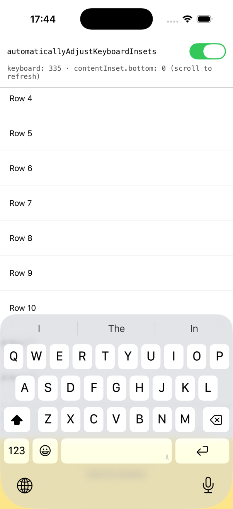
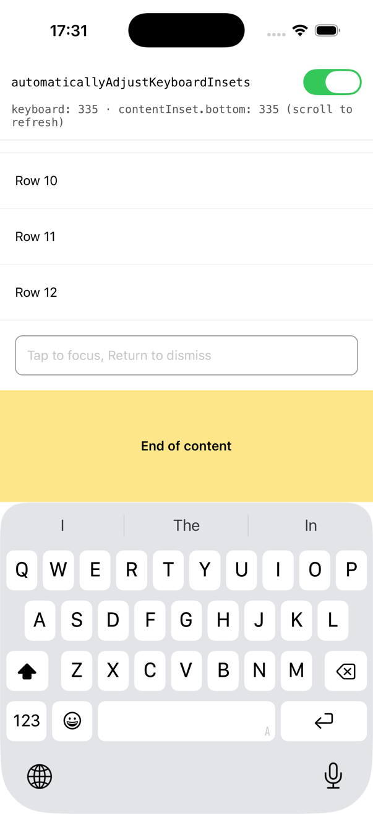
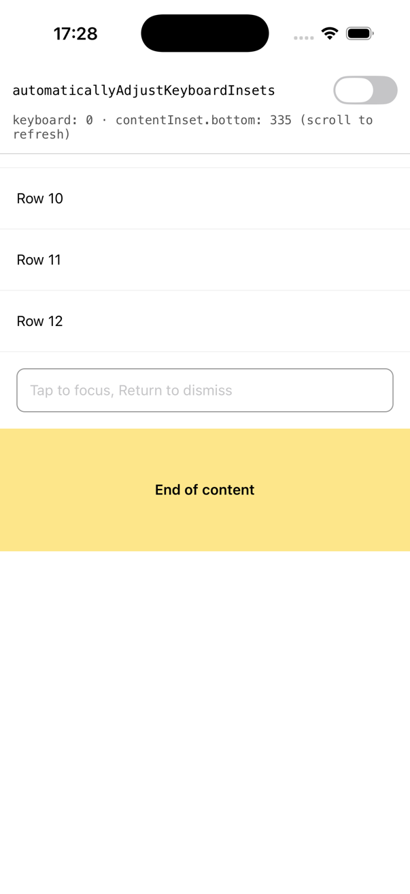
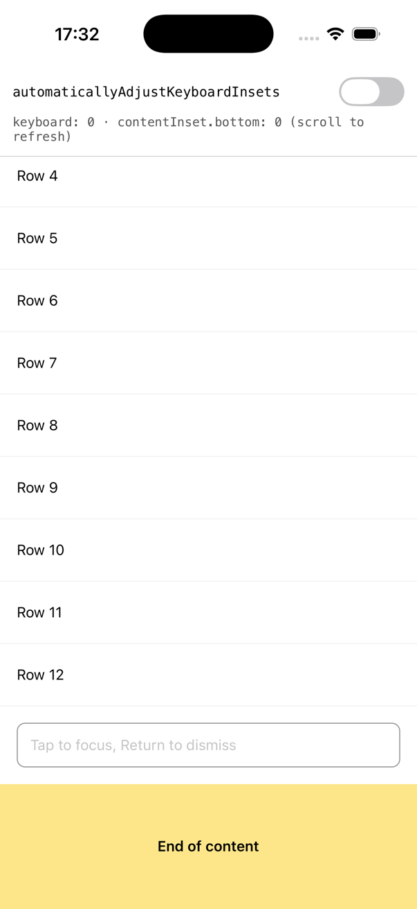

# `automaticallyAdjustKeyboardInsets` ignores changes made while the keyboard is visible (iOS)

On iOS, `ScrollView`'s `automaticallyAdjustKeyboardInsets` only does anything
when a `UIKeyboardWillChangeFrameNotification` arrives. If the prop changes
while the keyboard is already on screen, nothing happens:

- **Turned on while the keyboard is up:** the ScrollView gets no keyboard
  inset. The end of the content stays behind the keyboard and can't be
  scrolled into view, until the keyboard is hidden and shown again.
- **Turned off while the keyboard is up:** the keyboard inset stays. The
  keyboard's hide notification is ignored too, since the prop is now off, so
  the inset is never removed. That leaves a keyboard-sized gap at the end of
  the content for good.

The cause is in `RCTScrollViewComponentView.mm`. `_keyboardWillChangeFrame:`
returns early when the flag is off, and `updateProps` only stores the new
value of the flag, without applying or removing anything.

## Filed as

- React Native: [react/react-native#59305](https://github.com/react/react-native/issues/59305)
- Fix: [react/react-native#59306](https://github.com/react/react-native/pull/59306) (the `fixed` branch of this repo applies the same change)

## Environment

| | |
| --- | --- |
| react-native | 0.88.0 |
| react | 19.3.0 |
| Architecture | New (Fabric), Hermes |
| Reproduced on | iOS Simulator, iPhone 17, iOS 26.5, Release build (Xcode 27.1) |
| Dependencies | None beyond the template |

## Steps to reproduce

```bash
cd ReproducerApp
yarn install
(cd ios && bundle install && bundle exec pod install)
yarn ios --mode Release
```

The app has a Switch for `automaticallyAdjustKeyboardInsets` (off at launch),
and a ScrollView with some rows, a text input and a yellow "End of content"
block. The Switch keeps the keyboard up when you flip it
(`keyboardShouldPersistTaps="handled"`), and Return dismisses the keyboard. The
readout under the Switch shows the keyboard height and the ScrollView's
`contentInset.bottom`, taken from the last `onScroll` event, so scroll a little
to refresh it.

### A: turn the prop on while the keyboard is up

1. With the Switch off, tap the input. The keyboard comes up.
2. Turn the Switch on.
3. Scroll to the bottom.

**Expected:** the ScrollView gets the keyboard inset, the same as if the prop
had been on before the keyboard appeared. "End of content" scrolls into view
above the keyboard.

**Actual:** `contentInset.bottom` stays 0 and "End of content" stays behind the
keyboard.

| Stock | Fixed |
| --- | --- |
|  |  |

### B: turn the prop off while the keyboard is up

1. With the Switch on, tap the input. The inset is applied as normal.
2. Turn the Switch off.
3. Press Return to dismiss the keyboard, then scroll to the bottom.

**Expected:** the keyboard inset is removed, so the content ends at the bottom
of the ScrollView.

**Actual:** `contentInset.bottom` stays at the keyboard height (335) after the
keyboard has gone, leaving a blank gap under "End of content". It stays until
the prop is turned on and the keyboard moves again.

| Stock | Fixed |
| --- | --- |
|  |  |

### Results

iPhone 17 simulator, iOS 26.5, Release builds, keyboard height 335pt.
`contentInset.bottom` at the end of each scenario:

| Scenario | stock | fixed |
| --- | ---: | ---: |
| Control: prop on before the keyboard appears | 335 | 335 |
| **A: prop turned on with the keyboard up** | **0** | 335 |
| **B: prop turned off with the keyboard up, then keyboard hidden** | **335** | 0 |

With the fix, flipping the prop while the keyboard is hidden changes nothing:
the inset stays 0 and the content doesn't move. In B, the inset is removed as
soon as the Switch turns off, before the keyboard is dismissed.

On stock, A reproduced in 5 of 6 runs. In the other one, the inset showed up
after a few swipes. We couldn't find a cause or make it happen again, including
by repeating the same gestures.

## How we hit it

In the Bluesky app, bottom sheets turn `automaticallyAdjustKeyboardInsets` on
only once the sheet reports that it's at its full-height detent, because at
smaller detents UIKit moves the sheet above the keyboard itself. That report is
an event from native, so it reaches the ScrollView's props a little after the
sheet starts presenting. A sheet whose text input has `autoFocus` raises the
keyboard during presentation, before that event lands. The keyboard
notification arrives while the prop is still off, so the sheet can't scroll
until the keyboard is dismissed and shown again. Dragging a sheet up to full
height while typing hits the same gap.

A standalone version of that, with the prop set from a `useEffect` next to an
autofocused input, didn't reproduce (0 out of 3): there the effect's commit
landed before the keyboard notification. So this repro flips the prop directly
instead.

## The `fixed` branch

The `fixed` branch adds the fix as a `patch-package` patch
(`ReproducerApp/patches/react-native+0.88.0.patch`). It keeps the keyboard's end
frame from every notification, including those that arrive while the prop is
off. When `updateProps` sees the prop change while the keyboard is visible, it
applies the inset as if the keyboard had just appeared, or removes it and
clamps the content offset to the smaller scrollable range.

The core has to be built from source for the patch to take effect:

```bash
git checkout fixed
cd ReproducerApp
yarn install    # postinstall applies the patch
(cd ios && RCT_USE_PREBUILT_RNCORE=0 bundle exec pod install)
yarn ios --mode Release
```
